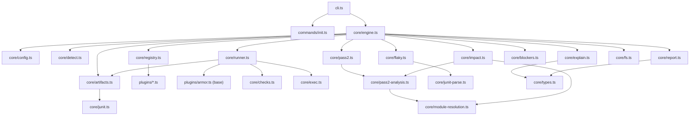
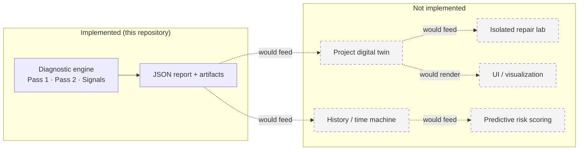

# Architecture

**Baseline:** commit `0313c5b` · `@deepdrop/diagnose@0.2.0`
**Evidence classes:** EXECUTED (reproduced here), TESTED (automated test), SOURCE-VERIFIED (read from implementation), UNTESTED.

This document describes the system as implemented. Planned capabilities are drawn separately and are never presented as existing.

## 1. Shape of the system

One CLI process, one repository root, one run:

```
deepdiagnose [--cassette name] [flags]
   │
   ├─ find repo root ── config ── resolve target
   │
   ├─ load plugins (built-ins + configured folders)
   │
   ├─ PASS 1  Syntax & Structure
   │    armor (base, always) ──gate──▶ language plugins
   │         └─ exec tools ─▶ artifacts/<plugin>/junit.xml + report.json
   │    reconcile blockers.json / UNRESOLVED.md
   │
   ├─ PASS 2  Logic & Debt  (reads Pass 1 output, never re-runs a linter)
   │    HTML refs · JS/TS module graph · Python relative imports
   │    blocker triage · optional automation (--fix) ─▶ re-run Pass 1 to prove it
   │
   ├─ SIGNALS (read-only)
   │    flaky history (JUnit) · impact selection (git diff + graph) · triage (--ai-explain)
   │
   └─ diagnostic-report.json ──▶ console summary / exit code
```

## 2. Implemented components

| Layer | File | Lines | Responsibility |
|---|---|---|---|
| CLI | `src/cli.ts` | 97 | commander wiring, flags, exit code, `init` subcommand |
| Init | `src/commands/init.ts` | 151 | write `diagnose.config.json`, add `diagnose` script; idempotent |
| Engine | `src/core/engine.ts` | 283 | root/target resolution, plugin load, pass orchestration, signal wiring, report, exit code |
| Registry | `src/core/registry.ts` | 93 | dynamic ESM import of plugin folders, duplicate-id rejection, base-first ordering |
| Detection | `src/core/detect.ts` | 91 | repo-root walk (`.git`, workspaces), cassette resolution, project kind hints |
| Config | `src/core/config.ts` | 114 | `diagnose.config.json` (+ legacy name), defaults, armor helpers |
| Runner | `src/core/runner.ts` | 122 | base-first execution, armor gate, blocked results, artifact finalize |
| Execution | `src/core/exec.ts` | 69 | `spawn` with `shell: false` for all plugin commands; the Apple plugin adds two explicit `/bin/sh -c` pipelines with quoted values; 240 s timeout, 20 kB output tail |
| Checks | `src/core/checks.ts` | 91 | check construction, `skipped` vs `notApplicable`, captured JSON |
| Artifacts | `src/core/artifacts.ts` | 136 | per-plugin folders, JUnit merge/adopt, contract finalize, aggregate JUnit |
| JUnit | `src/core/junit.ts` | 100 | XML escaping, synthesized JUnit, suite extraction |
| JUnit reader | `src/core/junit-parse.ts` | 120 | parse JUnit into normalized cases (flaky input) |
| Pass 2 | `src/core/pass2.ts` | 214 | findings, blocker triage, fix handlers, fix verification |
| Pass 2 analysis | `src/core/pass2-analysis.ts` | 339 | HTML refs, import/symbol graph, Python relative imports, file collection |
| Resolution | `src/core/module-resolution.ts` | 542 | tsconfig (`extends`, `paths`), per-project selection, NodeNext `.js`→`.ts` |
| Impact | `src/core/impact.ts` | 345 | diff collection, graph adapter, optional `@mizchi/test-impact` |
| Flaky | `src/core/flaky.ts` | 232 | history, scoring, per-commit evidence |
| Explain | `src/core/explain.ts` | 352 | rule taxonomy, optional model call, cache |
| Blockers | `src/core/blockers.ts` | 242 | ledger reconciliation, board rendering |
| Reporting | `src/core/report.ts` | 352 | console summary, JSON writer |
| Types | `src/core/types.ts` | 355 | report/plugin/context contracts |
| Filesystem | `src/core/fs.ts` | 106 | bounded BFS, JSON read, ignore list |
| Plugins | `src/plugins/*.ts` | 963 | 9 ecosystem detectors + `armor` base |

Line counts and imports are SOURCE-VERIFIED; the totals above sum the current tree.

## 3. Dependencies between modules



Edges are SOURCE-VERIFIED from `import` statements. `impact.ts` imports `extractImports` from Pass 2 analysis, which is why the two share one resolver.

## 4. Pass 1

1. `loadPlugins` imports every `.ts/.js/.mjs` in the built-in folder plus configured folders; duplicate `id` throws; `base` plugins sort first.
2. `runPlugins` calls `detect(ctx)`; a throwing detector becomes a failed check, not a crash.
3. Angel Armor (`base: true`, `detect()` always true) runs the configured scripts. When it fails and the gate is on, every later plugin is recorded `blocked`, and its stale artifact folder is deleted so CI cannot upload old results.
4. A detected plugin gets a fresh artifact folder, runs its tools, and returns `CheckResult[]`.
5. `finalizeArtifacts` guarantees `junit.xml` and `report.json` exist: native JUnit when the tool writes it, synthesized JUnit from checks otherwise.
6. `reconcileBlockers` updates the ledger and regenerates `UNRESOLVED.md`.

## 5. Pass 2

Pass 2 consumes Pass 1's output and the ledger; it runs no linter.

- **HTML → assets:** `<script src>`, `<link href>`, `` must exist; root-absolute paths are warnings.
- **JS/TS graph:** relative and root-absolute specifiers resolve through `module-resolution.ts`; named imports are checked against the target's exports (regex-based, conservative). `export *` and CommonJS targets are skipped.
- **Python:** relative imports (`from .pkg import x`) must land on a module. This is an existence check, **not** a dependency graph.
- **Triage:** every open blocker becomes `auto-fixable` or `manual` with a concrete action.
- **Automation:** the only current handler writes a `cargo-nextest` JUnit profile. With `--fix`, Pass 1 is re-run and Pass 2 re-analyzed, so a fix is only claimed after a green run.

## 6. Signals

| Signal | Input | Output | Executes tests? |
|---|---|---|---|
| Flaky | JUnit files under `artifacts/` + history | `artifacts/flaky/report.json`, `signals.flaky` | No |
| Impact | git diff, import graph, optional `test-impact` binary | `artifacts/impact/report.json`, `signals.impact` | No |
| Explain | failed check records | `artifacts/explain/report.json`, `signals.explain` | No (one HTTP call when enabled + key) |

## 7. Report and state

- `diagnostic-report.json`: `engine`, `engineVersion`, `generatedAt`, `target`, `artifacts`, `twoPass`, `summary`, `pass1`, `pass2`, `signals`, `blockers`, `availablePlugins`. (EXECUTED: keys read from a real run.)
- `blockers.json`: ledger, version 1.
- `UNRESOLVED.md`: generated board; never hand-edit.
- `artifacts/<plugin>/junit.xml` and `report.json`: always present after a plugin runs.
- `artifacts/junit.xml`: aggregate suites for CI reporters.
- `.deepdiagnose/flaky-history.json`, `.deepdiagnose/ai-cache.json`: local state.

There is **no schema version field** in the report at this baseline; adding one is planned (see [roadmap](roadmap.md)).

## 8. Planned, not implemented

Drawn apart deliberately; none of this exists in the code.



## 9. Extension points that exist today

- **Plugins:** drop an ESM file in a configured folder; contract is `{ id, label, base?, detect, run }`.
- **Report consumers:** the JSON report and `artifacts/*/report.json` are stable enough for external tools; there is no version field yet.
- **Impact adapters:** `@mizchi/test-impact` is used when installed; the graph is the fallback.
- **AI endpoint:** `DEEPDIAGNOSE_AI_BASE_URL` / `DEEPDIAGNOSE_AI_MODEL` point the triage call at any OpenAI-compatible endpoint.
